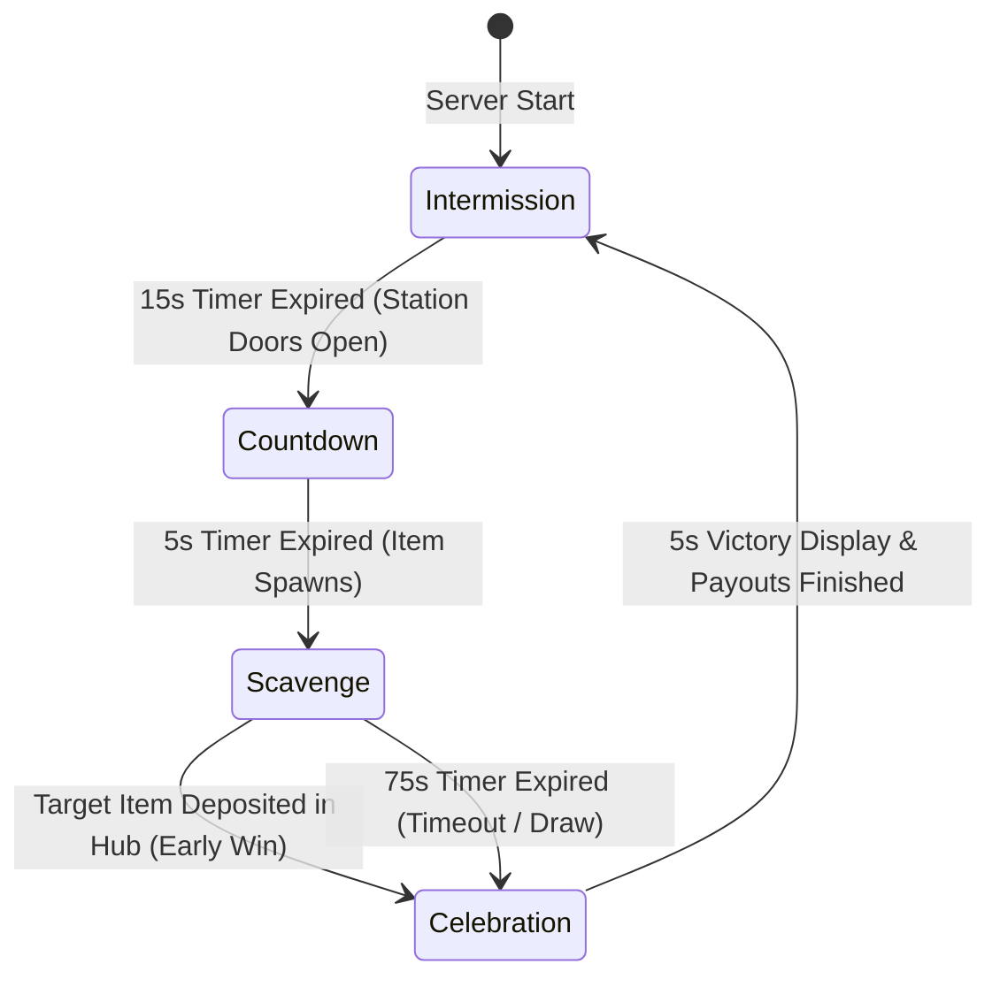

# "Bring Me" Roblox Scavenger Hunt — MVP Specification & Implementation Plan

## 1. System Architecture & Data Flow

### 1.1 Directory & Asset Structure

```
ReplicatedStorage/
├── Events/
│   ├── RoundStateChanged (RemoteEvent)       -- Broadcasts { State, TimeRemaining, TargetItemInfo }
│   ├── ItemPickupRequested (RemoteFunction)  -- Client asks to pick up item -> Server validates
│   ├── ItemStateChanged (RemoteEvent)        -- Broadcasts { ItemId, CarrierPlayer, Position }
│   ├── TagAttempt (RemoteFunction)           -- Client requests PvP tag on Carrier
│   ├── ActivatePowerUp (RemoteFunction)      -- Client activates consumable (SpeedBoost, Radar)
│   └── CurrencyUpdated (RemoteEvent)         -- Server notifies client of coin/stat updates
├── Modules/
│   ├── GameConfig (ModuleScript)             -- Central constants, timers, item catalogs
│   └── Types (ModuleScript)                  -- Shared type definitions
└── Assets/
    ├── TargetItems/ (Folder)                 -- Models with PrimaryPart for each spawnable item
    └── Tools/
        └── TagTool (Tool)                    -- Innate melee tag tool equipped to all players

ServerScriptService/
├── MainServer.server.luau                    -- Server entry point & service bootstrap
└── Modules/
    ├── RoundManager (ModuleScript)           -- State machine (Intermission, Countdown, Scavenge, Celebration)
    ├── ItemSpawner (ModuleScript)            -- Station picker, item instantiator, collision handling
    ├── CarrierManager (ModuleScript)         -- Overhead weld, highlight, speed suppression, deposit zone
    ├── PvPHitHandler (ModuleScript)          -- Hit validation, whiff cooldown, drop physics & immunity
    ├── EconomyManager (ModuleScript)         -- Coin payouts, power-up inventory, DevProduct purchase handler
    └── LeaderboardManager (ModuleScript)     -- Player leaderstats & Hub OrderedDataStore billboard

ServerStorage/
└── Stations/ (Folder)                        -- Folders per station with SpawnParts

Workspace/
├── Hub/
│   ├── SpawnLocation
│   ├── DepositZone (Part with Touched/Zone detection)
│   ├── SafeZone (Boundary part defining non-PvP zone)
│   ├── PromptScreen (Model with SurfaceGui)
│   └── LeaderboardBillboard (Model with SurfaceGui)
└── Stations/
    ├── Library/
    ├── ScienceLab/
    └── Gymnasium/
```

---

### 1.2 State Machine & Event Flow



---

## 2. Core Roblox Lua Scripts

### 2.1 Game Configuration (`ReplicatedStorage.Modules.GameConfig`)

```lua
--!strict
local GameConfig = {
    Timers = {
        Intermission = 15,
        Countdown = 5,
        Scavenge = 75,
        Celebration = 5,
    },
    
    Speeds = {
        DefaultWalkSpeed = 16,
        SpeedBoostWalkSpeed = 24,
        SpeedBoostDuration = 5,
    },
    
    Combat = {
        WhiffCooldown = 1.0,
        TagRange = 7.5, -- Studs
        VictimImmunityDuration = 1.5,
        DropPickupDebounce = 1.5,
    },
    
    Economy = {
        ParticipationCoins = 15,
        WinnerBonusCoins = 50,
        PowerUps = {
            SpeedBoost = { Cost = 30, Duration = 5 },
            ItemRadar = { Cost = 45, Duration = 5 },
        },
    },
    
    Items = {
        { Id = "Microscope", Name = "Microscope", Station = "ScienceLab", ModelName = "MicroscopeModel" },
        { Id = "AncientTome", Name = "Ancient Tome", Station = "Library", ModelName = "TomeModel" },
        { Id = "Basketball", Name = "Basketball", Station = "Gymnasium", ModelName = "BasketballModel" },
        { Id = "ErlenmeyerFlask", Name = "Chemistry Flask", Station = "ScienceLab", ModelName = "FlaskModel" },
        { Id = "Dumbbell", Name = "Heavy Dumbbell", Station = "Gymnasium", ModelName = "DumbbellModel" },
    }
}

return table.freeze(GameConfig)
```

---

### 2.2 Round Manager (`ServerScriptService.Modules.RoundManager`)

```lua
--!strict
local Players = game:GetService("Players")
local ReplicatedStorage = game:GetService("ReplicatedStorage")
local GameConfig = require(ReplicatedStorage.Modules.GameConfig)
local ItemSpawner = require(script.Parent.ItemSpawner)
local CarrierManager = require(script.Parent.CarrierManager)
local EconomyManager = require(script.Parent.EconomyManager)

local RoundStateChanged = ReplicatedStorage.Events.RoundStateChanged

local RoundManager = {}
RoundManager.CurrentState = "Intermission"
RoundManager.TimeRemaining = 0
RoundManager.ActiveTargetItem = nil :: any
RoundManager.WinningPlayer = nil :: Player?
RoundManager.IsRoundActive = false

function RoundManager.Init()
    CarrierManager.OnItemDeposited:Connect(function(player: Player, itemModel: Model)
        RoundManager.EndRound(player)
    end)
    
    task.spawn(RoundManager.GameLoop)
end

function RoundManager.GameLoop()
    while true do
        -- 1. INTERMISSION
        RoundManager.CurrentState = "Intermission"
        RoundManager.WinningPlayer = nil
        RoundManager.ActiveTargetItem = ItemSpawner.SelectRandomItem()
        RoundManager.BroadcastState()
        
        for t = GameConfig.Timers.Intermission, 1, -1 do
            RoundManager.TimeRemaining = t
            RoundStateChanged:FireAllClients(RoundManager.CurrentState, t, RoundManager.ActiveTargetItem)
            task.wait(1)
        end
        
        -- 2. COUNTDOWN
        RoundManager.CurrentState = "Countdown"
        RoundManager.BroadcastState()
        for t = GameConfig.Timers.Countdown, 1, -1 do
            RoundManager.TimeRemaining = t
            RoundStateChanged:FireAllClients(RoundManager.CurrentState, t, RoundManager.ActiveTargetItem)
            task.wait(1)
        end
        
        -- 3. SCAVENGE
        RoundManager.CurrentState = "Scavenge"
        RoundManager.IsRoundActive = true
        local spawnedItem = ItemSpawner.SpawnItem(RoundManager.ActiveTargetItem)
        CarrierManager.SetActiveItem(spawnedItem)
        
        local roundElapsed = 0
        while RoundManager.IsRoundActive and roundElapsed < GameConfig.Timers.Scavenge do
            RoundManager.TimeRemaining = GameConfig.Timers.Scavenge - roundElapsed
            RoundStateChanged:FireAllClients(RoundManager.CurrentState, RoundManager.TimeRemaining, RoundManager.ActiveTargetItem)
            task.wait(1)
            roundElapsed += 1
        end
        
        -- 4. CELEBRATION / REWARD
        RoundManager.CurrentState = "Celebration"
        RoundManager.IsRoundActive = false
        ItemSpawner.CleanupItem()
        CarrierManager.ResetCarrier()
        
        if RoundManager.WinningPlayer then
            EconomyManager.AwardWinner(RoundManager.WinningPlayer)
        end
        EconomyManager.AwardParticipation(RoundManager.WinningPlayer)
        
        for t = GameConfig.Timers.Celebration, 1, -1 do
            RoundManager.TimeRemaining = t
            RoundStateChanged:FireAllClients(RoundManager.CurrentState, t, RoundManager.ActiveTargetItem, RoundManager.WinningPlayer)
            task.wait(1)
        end
    end
end

function RoundManager.EndRound(winner: Player?)
    if not RoundManager.IsRoundActive then return end
    RoundManager.WinningPlayer = winner
    RoundManager.IsRoundActive = false
end

function RoundManager.BroadcastState()
    RoundStateChanged:FireAllClients(RoundManager.CurrentState, RoundManager.TimeRemaining, RoundManager.ActiveTargetItem)
end

return RoundManager
```

---

### 2.3 Item Spawner (`ServerScriptService.Modules.ItemSpawner`)

```lua
--!strict
local Workspace = game:GetService("Workspace")
local ReplicatedStorage = game:GetService("ReplicatedStorage")
local GameConfig = require(ReplicatedStorage.Modules.GameConfig)

local ItemSpawner = {}
local currentSpawnedModel: Model? = nil

function ItemSpawner.SelectRandomItem()
    local items = GameConfig.Items
    local randomIndex = math.random(1, #items)
    return items[randomIndex]
end

function ItemSpawner.SpawnItem(itemData: any): Model
    ItemSpawner.CleanupItem()
    
    local template = ReplicatedStorage.Assets.TargetItems:FindFirstChild(itemData.ModelName)
    assert(template, "Model not found: " .. itemData.ModelName)
    
    local itemModel = template:Clone() :: Model
    itemModel.Name = "ActiveTargetItem"
    itemModel:SetAttribute("ItemId", itemData.Id)
    itemModel:SetAttribute("CanPickup", true)
    
    -- Pick random spawn point within the designated station
    local stationFolder = Workspace.Stations:FindFirstChild(itemData.Station)
    local spawnPoints = stationFolder and stationFolder:FindFirstChild("SpawnPoints")
    local chosenCFrame = CFrame.new(0, 5, 0)
    
    if spawnPoints and #spawnPoints:GetChildren() > 0 then
        local children = spawnPoints:GetChildren()
        local randomSpawn = children[math.random(1, #children)] :: BasePart
        chosenCFrame = randomSpawn.CFrame + Vector3.new(0, 2, 0)
    end
    
    itemModel:PivotTo(chosenCFrame)
    itemModel.Parent = Workspace
    currentSpawnedModel = itemModel
    
    -- Add ProximityPrompt on server
    local prompt = Instance.new("ProximityPrompt")
    prompt.ActionText = "Grab Target Item"
    prompt.ObjectText = itemData.Name
    prompt.HoldDuration = 0
    prompt.MaxActivationDistance = 8
    prompt.RequiresLineOfSight = false
    prompt.Parent = itemModel.PrimaryPart or itemModel:FindFirstChildWhichIsA("BasePart")
    
    return itemModel
end

function ItemSpawner.CleanupItem()
    if currentSpawnedModel then
        currentSpawnedModel:Destroy()
        currentSpawnedModel = nil
    end
end

return ItemSpawner
```

---

### 2.4 Carrier Manager (`ServerScriptService.Modules.CarrierManager`)

```lua
--!strict
local Players = game:GetService("Players")
local Workspace = game:GetService("Workspace")
local ReplicatedStorage = game:GetService("ReplicatedStorage")
local GameConfig = require(ReplicatedStorage.Modules.GameConfig)

local ItemStateChanged = ReplicatedStorage.Events.ItemStateChanged

local CarrierManager = {}
CarrierManager.CurrentCarrier = nil :: Player?
CarrierManager.CurrentItemModel = nil :: Model?
CarrierManager.OnItemDeposited = Instance.new("BindableEvent")

local activeWeld: WeldConstraint? = nil
local activeHighlight: Highlight? = nil

function CarrierManager.SetActiveItem(itemModel: Model)
    CarrierManager.CurrentItemModel = itemModel
    
    local rootPart = itemModel.PrimaryPart or itemModel:FindFirstChildWhichIsA("BasePart")
    if not rootPart then return end
    
    local prompt = rootPart:FindFirstChildWhichIsA("ProximityPrompt")
    if prompt then
        prompt.Triggered:Connect(function(player: Player)
            CarrierManager.AssignCarrier(player)
        end)
    end
end

function CarrierManager.AssignCarrier(player: Player)
    if CarrierManager.CurrentCarrier or not CarrierManager.CurrentItemModel then return end
    
    local character = player.Character
    if not character then return end
    local head = character:FindFirstChild("Head") :: BasePart?
    local humanoid = character:FindFirstChildWhichIsA("Humanoid")
    if not head or not humanoid or humanoid.Health <= 0 then return end
    
    -- Check pickup debounce attribute (post-drop immunity)
    local dropDebounce = character:GetAttribute("DropDebounceUntil") or 0
    if os.clock() < dropDebounce then return end
    
    CarrierManager.CurrentCarrier = player
    local item = CarrierManager.CurrentItemModel
    
    -- Disable ProximityPrompt while carried
    local rootPart = item.PrimaryPart or item:FindFirstChildWhichIsA("BasePart")
    local prompt = rootPart and rootPart:FindFirstChildWhichIsA("ProximityPrompt")
    if prompt then prompt.Enabled = false end
    
    -- Enforce speed restriction & suppress speed boost
    humanoid.WalkSpeed = GameConfig.Speeds.DefaultWalkSpeed
    character:SetAttribute("SpeedBoostActive", false)
    
    -- Overhead Weld
    rootPart.CanCollide = false
    item:PivotTo(head.CFrame * CFrame.new(0, 2.5, 0))
    
    activeWeld = Instance.new("WeldConstraint")
    activeWeld.Part0 = head
    activeWeld.Part1 = rootPart
    activeWeld.Parent = rootPart
    
    -- Luminous Highlight outline
    activeHighlight = Instance.new("Highlight")
    activeHighlight.FillColor = Color3.fromRGB(255, 215, 0)
    activeHighlight.OutlineColor = Color3.fromRGB(255, 255, 255)
    activeHighlight.FillTransparency = 0.5
    activeHighlight.Adornee = character
    activeHighlight.Parent = character
    
    ItemStateChanged:FireAllClients(item:GetAttribute("ItemId"), player, rootPart.Position)
end

function CarrierManager.DropItem(forceVelocity: Vector3?)
    if not CarrierManager.CurrentCarrier or not CarrierManager.CurrentItemModel then return end
    
    local victim = CarrierManager.CurrentCarrier
    local character = victim.Character
    local item = CarrierManager.CurrentItemModel
    local rootPart = item.PrimaryPart or item:FindFirstChildWhichIsA("BasePart")
    
    -- Clean up welds & highlights
    if activeWeld then activeWeld:Destroy(); activeWeld = nil end
    if activeHighlight then activeHighlight:Destroy(); activeHighlight = nil end
    
    CarrierManager.CurrentCarrier = nil
    
    -- Victim cooldowns & immunity
    if character then
        character:SetAttribute("DropDebounceUntil", os.clock() + GameConfig.Combat.DropPickupDebounce)
        character:SetAttribute("TagImmunityUntil", os.clock() + GameConfig.Combat.VictimImmunityDuration)
    end
    
    -- Physics drop into Workspace
    if rootPart then
        rootPart.CanCollide = true
        rootPart.AssemblyLinearVelocity = forceVelocity or Vector3.new(math.random(-5, 5), 15, math.random(-5, 5))
        
        task.delay(0.5, function()
            local prompt = rootPart:FindFirstChildWhichIsA("ProximityPrompt")
            if prompt then prompt.Enabled = true end
        end)
    end
    
    ItemStateChanged:FireAllClients(item:GetAttribute("ItemId"), nil, rootPart and rootPart.Position)
end

function CarrierManager.ResetCarrier()
    if activeWeld then activeWeld:Destroy(); activeWeld = nil end
    if activeHighlight then activeHighlight:Destroy(); activeHighlight = nil end
    CarrierManager.CurrentCarrier = nil
    CarrierManager.CurrentItemModel = nil
end

-- Deposit Zone Listener
local depositZone = Workspace.Hub:WaitForChild("DepositZone") :: BasePart
depositZone.Touched:Connect(function(hit)
    local character = hit.Parent
    local player = Players:GetPlayerFromCharacter(character)
    if player and player == CarrierManager.CurrentCarrier then
        local depositedItem = CarrierManager.CurrentItemModel
        CarrierManager.ResetCarrier()
        CarrierManager.OnItemDeposited:Fire(player, depositedItem)
    end
end)

return CarrierManager
```

---

### 2.5 PvP Hit Handler (`ServerScriptService.Modules.PvPHitHandler`)

```lua
--!strict
local Players = game:GetService("Players")
local Workspace = game:GetService("Workspace")
local ReplicatedStorage = game:GetService("ReplicatedStorage")
local GameConfig = require(ReplicatedStorage.Modules.GameConfig)
local CarrierManager = require(script.Parent.CarrierManager)

local TagAttempt = ReplicatedStorage.Events.TagAttempt

local PvPHitHandler = {}
local attackerCooldowns: { [Player]: number } = {}

-- Safe Zone Spatial Check
function PvPHitHandler.IsInSafeZone(position: Vector3): boolean
    local safeZonePart = Workspace.Hub:FindFirstChild("SafeZone") :: BasePart?
    if not safeZonePart then return false end
    
    local relative = safeZonePart.CFrame:PointToObjectSpace(position)
    local halfSize = safeZonePart.Size / 2
    return math.abs(relative.X) <= halfSize.X 
       and math.abs(relative.Y) <= halfSize.Y 
       and math.abs(relative.Z) <= halfSize.Z
end

TagAttempt.OnServerInvoke = function(attacker: Player, targetCharacter: Model): (boolean, string)
    local now = os.clock()
    local lastAttack = attackerCooldowns[attacker] or 0
    if now - lastAttack < GameConfig.Combat.WhiffCooldown then
        return false, "Cooldown"
    end
    attackerCooldowns[attacker] = now
    
    -- Validate attacker character
    local attackerChar = attacker.Character
    if not attackerChar then return false, "NoCharacter" end
    local attackerHRP = attackerChar:FindFirstChild("HumanoidRootPart") :: BasePart?
    local targetHRP = targetCharacter and targetCharacter:FindFirstChild("HumanoidRootPart") :: BasePart?
    if not attackerHRP or not targetHRP then return false, "InvalidTarget" end
    
    -- Safe zone check
    if PvPHitHandler.IsInSafeZone(attackerHRP.Position) or PvPHitHandler.IsInSafeZone(targetHRP.Position) then
        return false, "SafeZoneProtected"
    end
    
    -- Range validation (anti-exploit)
    local distance = (attackerHRP.Position - targetHRP.Position).Magnitude
    if distance > GameConfig.Combat.TagRange then
        return false, "OutOfRange"
    end
    
    -- Immunity check on victim
    local immunityUntil = targetCharacter:GetAttribute("TagImmunityUntil") or 0
    if now < immunityUntil then
        return false, "TargetImmune"
    end
    
    -- Validate that target is the active Carrier
    local targetPlayer = Players:GetPlayerFromCharacter(targetCharacter)
    if targetPlayer and targetPlayer == CarrierManager.CurrentCarrier then
        -- Execute tag drop! Calculate directional knockback impulse
        local knockbackDirection = (targetHRP.Position - attackerHRP.Position).Unit
        local dropImpulse = (knockbackDirection * 15) + Vector3.new(0, 10, 0)
        CarrierManager.DropItem(dropImpulse)
        return true, "Success"
    end
    
    return false, "NotCarrier"
end

return PvPHitHandler
```

---

## 3. Monetization & Economy Balance Plan

### 3.1 Currency Flow Equations

$$\text{Session Earnings} = (\text{Rounds Played} \times 15) + (\text{Rounds Won} \times 50) + \text{VIP Bonus}(+20\%)$$

- **Average Round Cycle**: ~100 seconds (15s Intermission + 5s Countdown + ~75s Scavenge + 5s End).
- **Hourly Round Capacity**: ~36 rounds/hour.
- **Casual Player Payout (0 wins, 60% retention)**:
  $$\approx 20\text{ rounds} \times 15\text{ coins} = 300\text{ coins/hour}$$
- **Skilled Player Payout (6 wins/hour)**:
  $$(36 \times 15) + (6 \times 50) = 840\text{ coins/hour}$$

### 3.2 Pricing Matrix

| Store Item | Type | Currency | Cost | Utility & Sinks |
| :--- | :--- | :--- | :--- | :--- |
| **Speed Boost** | Consumable (1-use) | Soft Coins | **30 Coins** | 5s sprint at 24 studs/s. Costs ~2 rounds of casual play. |
| **Item Radar** | Consumable (1-use) | Soft Coins | **45 Coins** | 5s directional beacon directly to the station. Costs ~3 rounds of casual play. |
| **Pouch of Coins (250)** | Developer Product | Robux | **R\$ 25** | Instant access to ~8 Speed Boosts. |
| **Chest of Coins (1,000)** | Developer Product | Robux | **R\$ 75** | Best value soft-currency pack. |
| **VIP Gamepass** | Gamepass (Perm) | Robux | **R\$ 149** | +20% Coin multiplier on all payouts + Golden Tag Trail + Chat VIP Tag. |

---

## 4. Phase 2 Roadmap & Post-MVP Stretch Goals

### 4.1 Upgradeable Items & Character Gear
- **Cosmetic & Stat Gear**: Players can equip cosmetic backpacks, sneakers, and gloves that level up using earned Soft Currency or duplicate drops.
- **Stat Upgrades**:
  - *Sprint Cooldown Reduction*: Reduces recovery delay between speed power-up activations.
  - *Carry Resilience*: Extends the tag range required by attackers to successfully force an item drop (e.g. from 7.5 studs to 6.0 studs).
  - *Golden Gloves*: Grants cosmetic particle impacts when executing successful tags.

### 4.2 Dynamic Shop Restocks & Rarity Tiers
- **Rotating Daily Shop**: The Intermission shop shifts from static consumables to a timed daily rotation offering tiered cosmetic trails, custom Tag Tool skins, and limited-time item variants.
- **Rarity Distribution**:
  - *Common / Rare*: Bought with Soft Currency.
  - *Epic / Legendary*: Premium Robux or high-tier win milestone unlocks.
- **Stock Timers**: Client HUD displays a countdown timer indicating when the current shop rotation refreshes.

### 4.3 Station Hazards & Dynamic Vaults
- **Station Events**: Random in-round events (e.g. *Gym Floor Waxing* causing slippery ice physics, or *Library Quiet Time* where footsteps trigger sound beacons).
- **Secondary Safe Havens**: Smaller temporary safe zones inside distant stations requiring power-up keys to unlock.

